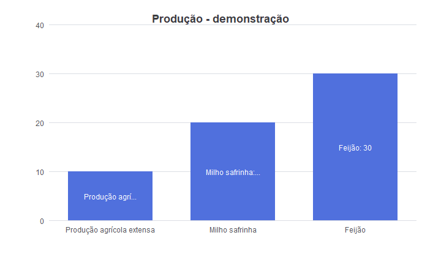

# Evidências preservadas — TDACChart, 22/09/2026

[Índice técnico](../../README.md) · [Interpretação dos testes](../../manual/08-testes-evidencias.md)
· [Manifesto de origem e hashes](manifest.json) · [Galeria de comparações](comparacoes.md)

Este arquivo preserva a execução anterior à consolidação documental. **Não é uma
baseline aprovada.** Não houve nova execução do renderer ao copiar estes artefatos.
Os sete hashes de fonte registrados na execução coincidem com o checkout lido na
consolidação; essa conferência está no manifesto.

## Resultado

- 29/29 casos passaram nos landmarks geométricos que o comparador mede.
- 28/29 passaram em conteúdo textual; V15 permanece reprovado por truncamento.
- Aparência completa e baseline Windows requerem revisão por elemento.
- Captura física contínua permanece inconclusiva; zero amostras desktop no ensaio final.
- Perfil 996 pontos/DPI 144: p95 de produção 16,976 ms, máximo 21,7541 ms.
- Carga 10.000: p95 119,5739 ms, máximo 135,4148 ms; fora do perfil de referência.

Relatórios originais: [comparação](dac/comparison.json), [temporal final](dac/temporal.json),
[métricas finais](dac/metrics.json), [ambiente](reports/os.json),
[manifesto da implementação](reports/implementation-manifest.json) e
[manifesto ECharts](reference/manifest.json).

## Conteúdo preservado

| Diretório | Conteúdo |
| --- | --- |
| `reference/` | 29 PNGs e JSONs ECharts, com opções resolvidas/layout/textos |
| `dac/` | Capturas DAC/DC da janela, geometria, overlay e diff por caso; galeria e resultados |
| `unit/` | Capturas dos asserts, DPI, dataset/lifecycle e pequenas sequências unitárias |
| `reports/` | Logs de compilação/testes, ambiente, hashes de origem e cópia das fixtures |
| `sequences/final/` | Índice/log da sequência estática de referência e relatórios |
| `sequences/animation/` | Índice/log da atualização animada 02 e relatórios |
| `sequences/screen/` | Índice/log da tentativa desktop 02 e relatórios |
| `sequences/load10000/` | Índice/log da carga adicional e relatórios |
| `frame-blobs/` | Todos os PNGs dessas quatro sequências, deduplicados por SHA-256 |

As sequências não foram reduzidas a três imagens exemplificativas: todos os PNGs
presentes nos diretórios originais dessas quatro execuções foram preservados.
Arquivos de bytes idênticos compartilham um blob. `index.json` de cada sequência
mapeia nome original → blob/hash/tamanho; `frames.jsonl` conserva IDs e timestamps.
Isso conserva o conteúdo observado, mas não cria quadros que a captura original
tenha deixado de observar.

O manifesto contém 655 mapeamentos de origem para artefatos, com duplicatas de
conteúdo compartilhadas. EXEs e DLLs originais são identificados por hash/tamanho,
sem duplicar os binários no manual. O bundle JS não foi incorporado ao runtime.
Fontes Windows não foram redistribuídas.

## Leitura visual

Exemplo V15, ainda reprovado. Referência ECharts:


Resultado DAC:



Sobreposição e mapa de diferenças estão na [galeria por cenário](comparacoes.md).
O mapa usa amplificação de delta para facilitar inspeção; não é um limiar de
aprovação. O texto distinto continua registrado nos JSONs e no relatório.

## Integridade e reconstrução de sequência

```powershell
python .\docs\charts\tools\verify_documentation.py
python .\docs\charts\tools\restore_sequence.py `
  .\docs\charts\evidence\2026-09-22\sequences\animation `
  .\tmp\animacao-restaurada
```

O restaurador exige saída inexistente, verifica hashes e reconstrói nomes PNG/log.
Não reproduz a aplicação, não cria vídeo e não aprova continuidade. Métricas e
opções ficam junto ao índice arquivado; o diretório reconstruído contém os frames.

## Limites de proveniência

A lista de fontes históricas não inclui todos os arquivos do checkout. Os hashes
atuais mais amplos estão no catálogo técnico, com data de consolidação distinta.
Não há inventário completo do hardware nem resolução por glifo da fonte Windows.
O relatório animado mais antigo tem menos campos que o relatório final; foi
preservado sem preencher retroativamente informações ausentes.

As origens `tmp/...` no manifesto são rastreabilidade, não dependências para abrir
essas evidências. Elas podem deixar de existir; os artefatos aqui preservados
continuam consultáveis. Nenhuma alteração de baseline foi aprovada nesta etapa.
