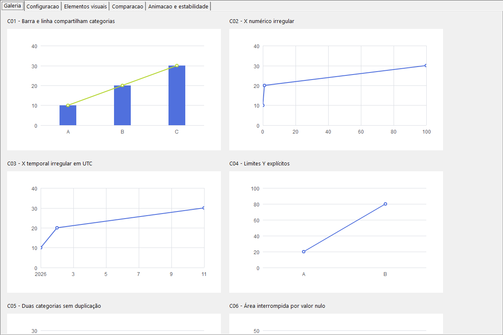

# Comparações por cenário

[Arquivo de evidências](README.md) · [Resultado por elemento](dac/comparison.json)

Imagens preservadas da execução histórica; nenhuma baseline foi aprovada na consolidação.

| ID / cenário | ECharts | DAC | Overlay | Diff | Geometria / texto |
| --- | --- | --- | --- | --- | --- |
| C01 — Barra e linha compartilham categorias | [PNG](reference/C01.png) | [PNG](dac/C01.png) | [50%](dac/C01-overlay.png) | [Delta](dac/C01-diff.png) | [ECharts](reference/C01.json) / [DAC](dac/C01.json) |
| C02 — X numérico irregular | [PNG](reference/C02.png) | [PNG](dac/C02.png) | [50%](dac/C02-overlay.png) | [Delta](dac/C02-diff.png) | [ECharts](reference/C02.json) / [DAC](dac/C02.json) |
| C03 — X temporal irregular em UTC | [PNG](reference/C03.png) | [PNG](dac/C03.png) | [50%](dac/C03-overlay.png) | [Delta](dac/C03-diff.png) | [ECharts](reference/C03.json) / [DAC](dac/C03.json) |
| C04 — Limites Y explícitos | [PNG](reference/C04.png) | [PNG](dac/C04.png) | [50%](dac/C04-overlay.png) | [Delta](dac/C04-diff.png) | [ECharts](reference/C04.json) / [DAC](dac/C04.json) |
| C05 — Duas categorias sem duplicação | [PNG](reference/C05.png) | [PNG](dac/C05.png) | [50%](dac/C05-overlay.png) | [Delta](dac/C05-diff.png) | [ECharts](reference/C05.json) / [DAC](dac/C05.json) |
| C06 — Área interrompida por valor nulo | [PNG](reference/C06.png) | [PNG](dac/C06.png) | [50%](dac/C06-overlay.png) | [Delta](dac/C06-diff.png) | [ECharts](reference/C06.json) / [DAC](dac/C06.json) |
| C07 — Barras positivas e negativas | [PNG](reference/C07.png) | [PNG](dac/C07.png) | [50%](dac/C07-overlay.png) | [Delta](dac/C07-diff.png) | [ECharts](reference/C07.json) / [DAC](dac/C07.json) |
| C08 — Rosca proporcional | [PNG](reference/C08.png) | [PNG](dac/C08.png) | [50%](dac/C08-overlay.png) | [Delta](dac/C08-diff.png) | [ECharts](reference/C08.json) / [DAC](dac/C08.json) |
| C09 — Pizza soma zero com default oficial | [PNG](reference/C09.png) | [PNG](dac/C09.png) | [50%](dac/C09-overlay.png) | [Delta](dac/C09-diff.png) | [ECharts](reference/C09.json) / [DAC](dac/C09.json) |
| C10 — Pizza soma zero sem setores fictícios | [PNG](reference/C10.png) | [PNG](dac/C10.png) | [50%](dac/C10-overlay.png) | [Delta](dac/C10-diff.png) | [ECharts](reference/C10.json) / [DAC](dac/C10.json) |
| C11 — Dataset orientado por colunas | [PNG](reference/C11.png) | [PNG](dac/C11.png) | [50%](dac/C11-overlay.png) | [Delta](dac/C11-diff.png) | [ECharts](reference/C11.json) / [DAC](dac/C11.json) |
| C12 — Dataset orientado por linhas | [PNG](reference/C12.png) | [PNG](dac/C12.png) | [50%](dac/C12-overlay.png) | [Delta](dac/C12-diff.png) | [ECharts](reference/C12.json) / [DAC](dac/C12.json) |
| C13 — Empilhamento mantém sinais separados | [PNG](reference/C13.png) | [PNG](dac/C13.png) | [50%](dac/C13-overlay.png) | [Delta](dac/C13-diff.png) | [ECharts](reference/C13.json) / [DAC](dac/C13.json) |
| C14 — Barras horizontais | [PNG](reference/C14.png) | [PNG](dac/C14.png) | [50%](dac/C14-overlay.png) | [Delta](dac/C14-diff.png) | [ECharts](reference/C14.json) / [DAC](dac/C14.json) |
| V01 — Titulos e labels | [PNG](reference/V01.png) | [PNG](dac/V01.png) | [50%](dac/V01-overlay.png) | [Delta](dac/V01-diff.png) | [ECharts](reference/V01.json) / [DAC](dac/V01.json) |
| V02 — Rich text nativo | [PNG](reference/V02.png) | [PNG](dac/V02.png) | [50%](dac/V02-overlay.png) | [Delta](dac/V02-diff.png) | [ECharts](reference/V02.json) / [DAC](dac/V02.json) |
| V03 — Gradiente e sombra | [PNG](reference/V03.png) | [PNG](dac/V03.png) | [50%](dac/V03-overlay.png) | [Delta](dac/V03-diff.png) | [ECharts](reference/V03.json) / [DAC](dac/V03.json) |
| V04 — Legenda paginada | [PNG](reference/V04.png) | [PNG](dac/V04.png) | [50%](dac/V04-overlay.png) | [Delta](dac/V04-diff.png) | [ECharts](reference/V04.json) / [DAC](dac/V04.json) |
| V05 — Area suave com lacuna | [PNG](reference/V05.png) | [PNG](dac/V05.png) | [50%](dac/V05-overlay.png) | [Delta](dac/V05-diff.png) | [ECharts](reference/V05.json) / [DAC](dac/V05.json) |
| V06 — Rosca com labels externos | [PNG](reference/V06.png) | [PNG](dac/V06.png) | [50%](dac/V06-overlay.png) | [Delta](dac/V06-diff.png) | [ECharts](reference/V06.json) / [DAC](dac/V06.json) |
| V07 — Texto rotacionado | [PNG](reference/V07.png) | [PNG](dac/V07.png) | [50%](dac/V07-overlay.png) | [Delta](dac/V07-diff.png) | [ECharts](reference/V07.json) / [DAC](dac/V07.json) |
| V08 — Dados vazios | [PNG](reference/V08.png) | [PNG](dac/V08.png) | [50%](dac/V08-overlay.png) | [Delta](dac/V08-diff.png) | [ECharts](reference/V08.json) / [DAC](dac/V08.json) |
| V09 — Um ponto e limites fixos | [PNG](reference/V09.png) | [PNG](dac/V09.png) | [50%](dac/V09-overlay.png) | [Delta](dac/V09-diff.png) | [ECharts](reference/V09.json) / [DAC](dac/V09.json) |
| V10 — Valores iguais | [PNG](reference/V10.png) | [PNG](dac/V10.png) | [50%](dac/V10-overlay.png) | [Delta](dac/V10-diff.png) | [ECharts](reference/V10.json) / [DAC](dac/V10.json) |
| V11 — Linha suavizada | [PNG](reference/V11.png) | [PNG](dac/V11.png) | [50%](dac/V11-overlay.png) | [Delta](dac/V11-diff.png) | [ECharts](reference/V11.json) / [DAC](dac/V11.json) |
| V12 — Area em degraus | [PNG](reference/V12.png) | [PNG](dac/V12.png) | [50%](dac/V12-overlay.png) | [Delta](dac/V12-diff.png) | [ECharts](reference/V12.json) / [DAC](dac/V12.json) |
| V13 — Eixos invertidos | [PNG](reference/V13.png) | [PNG](dac/V13.png) | [50%](dac/V13-overlay.png) | [Delta](dac/V13-diff.png) | [ECharts](reference/V13.json) / [DAC](dac/V13.json) |
| V14 — Linha conectando NULL | [PNG](reference/V14.png) | [PNG](dac/V14.png) | [50%](dac/V14-overlay.png) | [Delta](dac/V14-diff.png) | [ECharts](reference/V14.json) / [DAC](dac/V14.json) |
| V15 — Texto longo e acentos | [PNG](reference/V15.png) | [PNG](dac/V15.png) | [50%](dac/V15-overlay.png) | [Delta](dac/V15-diff.png) | [ECharts](reference/V15.json) / [DAC](dac/V15.json) |

## Galeria executada no demo

