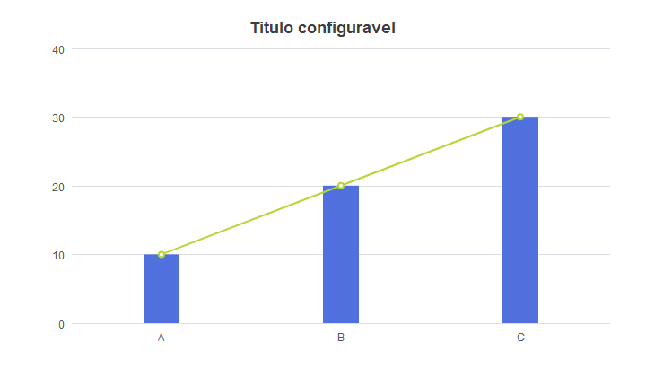
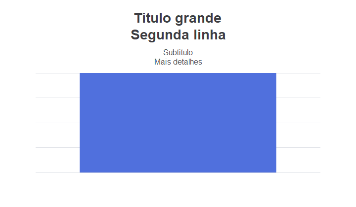

# Espaçamento do título — execução de 22/09/2026

[Manual](../../README.md) · [Contrato de layout](../../manual/04-geometria-desenho.md)
· [Manifesto](manifest.json)

Artefatos copiados em 23/09 de `tmp/chart-title-spacing`, sem executar novamente os
testes ou editar as imagens. Delphi Tokyo 10.2, Win32 Debug; fontes nativas Windows.

## Resultado observado

- Testes Delphi: sucesso, incluindo `TestChartTypes`, C01–C14, lifecycle e
  `TestTitleSpacing`. V01–V15 foram capturados; captura não é aprovação visual.
- TestTitleSpacing: seis variações (simples, várias linhas com subtítulo, fragmento
  rich text, apenas subtítulo, oculto e vazio), larguras lógicas 320/720/1280 e
  DPI sintético 96/120/144/192. São 72 combinações, mais remoção do título no mesmo
  engine e preservação de `grid.top=120`.
- Teste de separação: texto registrado no quadro termina ao menos 12 DIP antes
  da marca de valor máximo no limite superior do gráfico. Vazio/oculto/remoção
  restauram `grid.top=40`. Salvas 24 imagens da matriz, todas com largura lógica 720.
- Demo exclusivo: compilado, executado com fixture própria, `result.txt=OK`.
- O build dos testes teve sucesso na execução anterior, mas seu stdout não foi
  preservado em arquivo. Há comando de build e log de execução; não foi inventado
  um log de compilação retroativo. O build do demo tem log preservado.





## Arquivos e reprodução

| Diretório/arquivo | Conteúdo |
| --- | --- |
| [fixture.json](fixture.json) | C01 adaptado com título, usado no demo |
| [logs/tests.log](logs/tests.log) | Resultado dos testes Delphi |
| [logs/build-demo.log](logs/build-demo.log) | Compilação do demo; inclui hints |
| [demo/result.txt](demo/result.txt) | Confirmação de término automatizado |
| `commands/` | Scripts de build com saídas isoladas usados no ensaio |
| `titles/` | 24 capturas da matriz de título |
| `cases/` | PNG/JSON dos 29 casos existentes após a alteração |
| `demo/` | PNG, captura pontual da janela, geometria e galeria |

Após compilar o projeto do demo em uma saída isolada:

```powershell
& '.\DACChartsDemo.exe' --fixtures 'docs\charts\evidence\title-spacing-2026-09-22\fixture.json' --out 'tmp\novo-ensaio-titulo' --case all | Out-Null
```

Execute a partir da raiz do repositório, ajustando o caminho do EXE. O teste da
matriz é chamado pelo programa `Tests/DACComponentsCharts.dpr`, que recebe o caminho
de `Tests/Charts.Visual/fixtures.json` e uma pasta de saída nova.

## Limites de interpretação

O espaçamento é uma adaptação DAC: o grid efetivo passa a respeitar o título mesmo
se o `grid.top` configurado for menor. Não muda o JSON, nem centro/raio de pizza.
Não houve nova comparação integral contra ECharts, nova medição de performance,
passagem física entre monitores ou sequência independente de desktop nessa etapa.
A captura `title-spacing-window.png` é pontual e não prova ausência de flicker.

O manifesto registra SHA-256 dos artefatos copiados e hashes dos fontes/executáveis
encontrados na consolidação. Estes últimos não são um registro de proveniência
gerado pelo compilador no momento do build; essa distinção permanece explícita.
Os arquivos anteriores de comparação/baseline não foram alterados.
