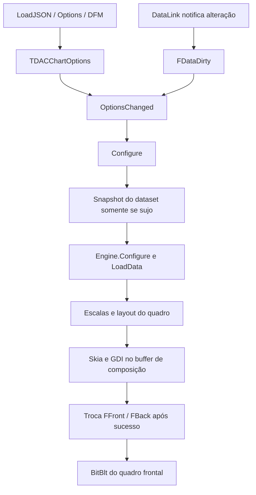

# 02 — Arquitetura e ciclo de vida

[Índice](../README.md) · [Configuração e dados](03-configuracao-dados.md)

## 1. Mapa de responsabilidades

| Unit | Responsabilidade | Principais pontos de entrada |
| --- | --- | --- |
| [Types](../../../Source/Core/DAC.Components.Charts.Types.pas) | Enums, sets, valores persistentes vinculados e conversão/validação estrita | `TDACChartTypes.Validate`, codecs, `TDACChartMeasure`, `TDACChartAxisLimit`, `TDACChartFill` |
| [Charts](../../../Source/Controls/DAC.Components.Controls.Charts.pas) | Host VCL, fonte externa, buffers frontal/traseiro, agenda, apresentação, eventos | `Create`, `LoadJSON`, `Configure`, `RenderFrame`, `Paint`, `DestroyWnd` |
| [Options](../../../Source/Controls/DAC.Components.Charts.Options.pas) | Árvore JSON, TPersistent, coleções e escrita transacional | `TDACChartOptionStore.Write`, `TDACChartOptions.SetJSON/Clone`; validação delegada a Types |
| [Engine](../../../Source/Skia/DAC.Components.Charts.Engine.pas) | Normalização dos dados, escalas, layout, pintura, marcas e hit-test | `LoadData`, `Render`, `Coord`, `DrawSeries`, `DrawPie`, `Text`, `HitTest` |
| [Surface](../../../Source/Skia/DAC.Components.Charts.Surface.pas) | Memória e integração Skia/GDI | `SetSize`, `Flush`, `OpaqueRect`, `Present`, `Release` |
| [Adapter do demo](../../../demo-charts/DACChartsDemo.ClientDataSetAdapter.pas) | Cursor independente TClientDataSet | `Supports`, `CreateReadCursor`, initialization/finalization |
| [Formulário](../../../demo-charts/DACChartsDemo.Main.pas) | Cenários e comandos usando a API pública | `BuildGallery`, `RunAutomatic`, `RunStress` |
| [Startup do demo](../../../demo-charts/DACChartsDemo.Startup.pas) | Pré-carga da DLL local antes de Skia; diagnóstico fatal | `PrepareRuntime`, `ReportDemoFailure`, initialization |

O demo inclui `MidasLib` estaticamente para não depender de MIDAS registrado no
Windows. Seus três DPRs usam Startup antes de Main. `HandleCreateException` deixa
o erro subir ao ponto de entrada, impedindo formulário parcial. Esse comportamento
é exclusivo do executável de demonstração, não um handler global da suíte.

O código atual separa o host, as opções e a superfície, mas dados/escalas/layout/
pintura/interação ainda convivem na mesma unit Engine. A separação conceitual do
plano não deve ser descrita como seis módulos já implementados.

`Render` chama `LayoutTitle(False)` antes de calcular as coordenadas finais do
gráfico; `TextHeight` usa o DC da superfície e `NativeFont`. A pintura chama
`LayoutTitle(True)` no mesmo buffer completo. A medição não publica quadro nem
reescreve opções. A regra de margem está no [capítulo 04](04-geometria-desenho.md).

## 2. Fluxo principal

`OptionsChanged` invalida configuração e desenho. Com handle existente, publica uma
mensagem `WM_APP+$461` e usa `FPosted` para evitar várias mensagens iguais pendentes.
Isso agrupa pedidos; não cria uma thread de renderização. As operações permanecem
na thread VCL. Consumidores devem transferir alterações de dados recebidas de outras
threads para a thread da interface.

## 3. Flags e transições

| Campo | Significado atual | Quem o altera |
| --- | --- | --- |
| `FDataDirty` | Snapshot externo precisa ser reconstruído | DataLink/RequeryData; ReadData limpa |
| `FConfigured` | Engine recebeu a configuração corrente | OptionsChanged limpa; Configure marca |
| `FDirty` | É necessário produzir outro quadro | Mouse, resize, timers, opções; RenderFrame limpa |
| `FPosted` | Mensagem de refresh já foi enfileirada | OptionsChanged / WMRefresh / DestroyWnd |
| `FRunning` | Interpolação temporal ativa | Configure / Stop / RenderFrame / DestroyWnd |
| `FShowAt/FHideAt` | Prazos de tooltip em ticks de 64 bits | MouseMove / MouseLeave / WMTimer |

Hover não marca dados externos como sujos, mas redesenha o quadro completo.
Alterações de aparência podem executar `Engine.Configure/LoadData` usando o snapshot
já existente. Portanto “não relê o dataset” não significa “não processa dados” nem
“pinta apenas o overlay”. Ainda não existe invalidação independente de todas as
camadas de dados/layout/aparência prevista no plano.

## 4. Ownership e vida útil

| Objeto/recurso | Dono e descarte |
| --- | --- |
| `FOptions`, `FEngine`, `FDataLink`, `FFrameTimes` | Criados/liberados pelo host |
| `FDataCache` | Array JSON substituído após leitura bem-sucedida; liberado pelo host |
| `FFront`, `FBack` | Duas instâncias de Surface; trocam de papel, não de dono |
| `FOptions` do engine | Clone JSON próprio; dados `Item/Options` apontam para nós dessa árvore |
| `FMarks`, `FTexts`, `FLabelBounds` | Evidências/posições do quadro; renovadas durante Render |
| `FPrevious`, `FHidden`, `FSelected` | Estado interno de transição/seleção |
| HFONTs | Cache do engine, limitado a 256 entradas; liberados no descarte do cache/engine |
| HDC/HBITMAP | Surface restaura o bitmap anterior, libera bitmap e DC |
| Cursor retornado pelo adapter | ReadData sempre o libera; não retornar o dataset original |
| Adapter registrado | Registro não assume ownership; o módulo registrador remove e libera |
| DataSource | Propriedade referenciada; FreeNotification, sem ownership do host |

Não guardar ponteiros para nós internos do JSON depois de `LoadJSON/Assign`.
`Engine.Options` e `Engine.Marks` são expostos para diagnóstico, mas a mutação direta
contorna a persistência, validação e invalidação do host. Não são uma API alternativa
recomendada para sistemas consumidores.

## 5. Criação, streaming e destruição

O construtor inicializa TStopwatch, buffers vazios, modelo, engine e DataLink. Define
720×420, TabStop e `csOpaque`; desativa o DoubleBuffered VCL porque a composição tem
buffers próprios. A criação sem Parent não precisa criar HWND. Setters durante
streaming podem marcar estado sujo, mas não devem forçar um DC de tela ou Parent.

`Loaded` invalida a configuração. `CreateWnd` tenta `GetDpiForWindow` por resolução
dinâmica e invalida novamente. `DestroyWnd` cancela o timer e limpa running/posted,
mas não zera todos os prazos pendentes de tooltip (ver capítulo 06);
a configuração reapresentada na criação seguinte pode iniciar uma nova animação.
O teste aguarda essa conclusão, não exige congelamento do frame durante a recriação.

No destructor, desativar notificações antes de liberar dependências e cancelar o
timer antes de destruir recursos gráficos. A fonte usa FreeNotification para que
sua destruição remova a associação. A remoção do DataSource e a destruição do dataset
não devem deixar referências utilizáveis ao cursor antigo.

## 6. Exceções e atomicidade

`LoadJSON` cria um engine de prova para validar opções/dados inline antes de alterar
o modelo persistente. Isso não lê o DataSource externo nem executa todas as rotinas
de desenho. Erros dependentes de pixels, fontes, layout ou dataset podem aparecer
somente no próximo quadro.

`RenderFrame` compõe em `FBack` e só troca os buffers após retorno bem-sucedido.
`Paint` reapresenta o frontal anterior em caso de exceção, depois chama OnDataError
ou relança. Na primeira pintura, se ainda não existe frontal válido, não há quadro
anterior garantido. O nome OnDataError não restringe sua chamada a erros de banco:
o bloco de Paint captura qualquer Exception.

## 7. Packages, hooks e limites

Os packages principal/runtime incluem Options, Engine e Surface. O registro de
TDACChart permanece nos mecanismos próprios da suíte. O style hook é localizado no
TDACChart, não registrado globalmente em TCustomControl. Validar estilos VCL no
host real: o teste isolado de raster não cobre todas as rotas de pintura por hook.

Mudar esses contratos exige compilar package, demo exclusivo e consumidores
internos, além de carregar os DFMs. Alteração de unit compilando isoladamente não
prova que a IDE consegue instanciar e editar o controle.
