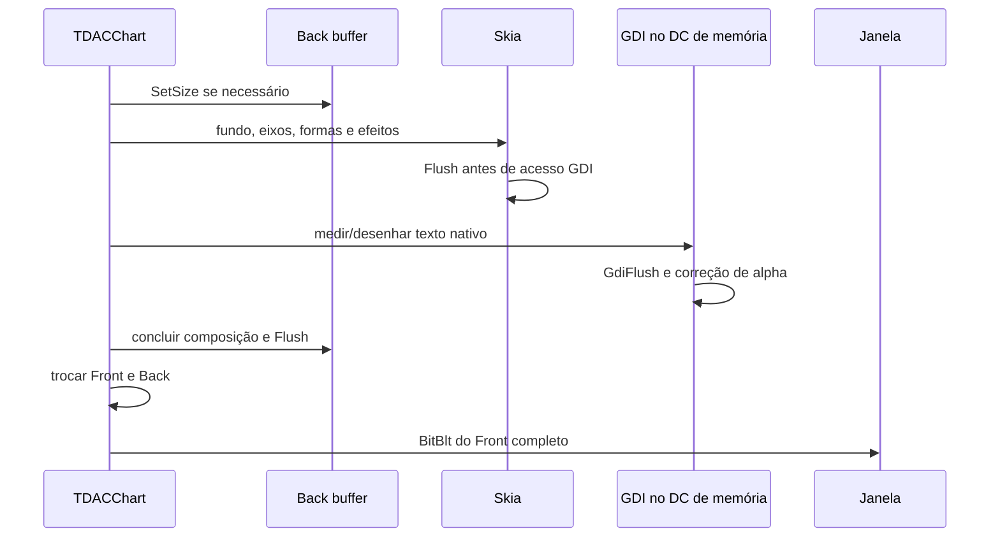

# 06 — Composição, animação, interação e estabilidade

[Índice](../README.md) · [Host](../../../Source/Controls/DAC.Components.Controls.Charts.pas)
· [Surface](../../../Source/Skia/DAC.Components.Charts.Surface.pas)

## Composição de um quadro

A reserva de espaço do título integra o layout do quadro completo: medição e
pintura usam a mesma superfície antes da apresentação. A correção não desenha
texto diretamente no HWND nem adiciona timers. Seus testes de geometria não
substituem a validação temporal de flicker descrita neste capítulo.



A ordem real intercala formas e texto por elemento; o diagrama resume as fronteiras
de sincronização. Não há thread de renderização independente: pintura e callbacks
executam no fluxo VCL. Uma callback lenta bloqueia a produção e a interface.

`TDACChartSurface` usa DIB top-down 32 bits, BI_RGB, DC compatível e bitmap selecionado
nesse DC. `MakeRasterDirect` recebe os pixels e stride `width*4`. O DC permite que
GDI escreva na mesma memória usada por Skia. O contrato Windows exige sincronização
ao compartilhar DIB entre acessos diretos e desenho GDI.
[CreateDIBSection](https://learn.microsoft.com/en-us/windows/win32/api/wingdi/nf-wingdi-createdibsection),
[GdiFlush](https://learn.microsoft.com/en-us/windows/win32/api/wingdi/nf-wingdi-gdiflush).

O buffer é reaproveitado com dimensões iguais. Em resize, o back prepara a nova
superfície e compõe antes da troca; o front anterior permanece disponível até o
sucesso. A liberação elimina a interface Skia, restaura o bitmap antigo no DC e
depois destrói bitmap/DC. Não excluir objetos GDI ainda selecionados.

`csOpaque` e `WM_ERASEBKGND` tratado evitam a limpeza intermediária do controle.
`DoubleBuffered` VCL fica falso porque o host faz sua própria composição. Isso
reduz caminhos conhecidos de flicker, mas não é uma prova de ausência de transientes
do desktop, do compositor, de ancestrais ou de mudanças reais de DPI.

Erro durante render tenta reapresentar o front anterior e chama `OnDataError` ou
propaga a exceção. Na primeira pintura pode não existir front válido; isso exige
tratamento específico para garantir um quadro de erro completo. Não aprovar
atomicidade de erro apenas pelo caso em que já existe uma imagem anterior.

## Invalidação e fontes de trabalho

| Gatilho | Dados externos | Configuração/layout/pintura |
| --- | --- | --- |
| Mudança de dataset/registro/atividade | Invalida snapshot | Reconfigura e pinta |
| Setter de opção | Reutiliza snapshot | Reconfigura engine, pode reiniciar animação |
| Hover | Reutiliza snapshot | Redesenha quadro completo |
| Resize/DPI | Reutiliza snapshot | Recalcula posições e buffer quando necessário |
| Timer de animação/tooltip | Reutiliza snapshot | Recalcula quadro |
| Exposição da janela sem dirty | Reutiliza snapshot | Pode reapresentar front sem produzir novo quadro |

Há distinção entre dados sujos, engine configurado e quadro sujo. Não há ainda
caches independentes completos de layout/paint nem dirty rectangles otimizados de
overlays. Redesenhar o quadro inteiro remove rastros no buffer, com custo maior.
Contadores devem separar leitura de dataset, parsing do cache, produção e apresentação.

## Relógio e agendamento

`TStopwatch` fornece timestamps monotônicos. Em Delphi Tokyo foi necessário chamar
`TStopwatch.Create` para inicializar sua frequência antes do uso estático; sem isso
houve tempos NaN durante o desenvolvimento. Não remover essa inicialização por
parecer um objeto sem uso. O contrato de tempo de alta resolução está descrito em
[QPC no Windows](https://learn.microsoft.com/en-us/windows/win32/sysinfo/acquiring-high-resolution-time-stamps).

Timer Windows de 33 ms solicita invalidação; não garante apresentação a cada 33 ms.
O progresso é calculado por tempo decorrido, não pelo número de ticks:

```text
t = min(1, (timestampAtual - inicio) * 1000 / frequencia / duracaoMs)
```

Se um tick atrasa, a próxima composição usa o tempo atual e pula estados
intermediários. Duração de entrada local: 1000 ms; atualização: 500 ms. Sem duração
positiva ou acima de animationThreshold default 2000 pontos, animação é desativada.
Design-time e ausência de handle também impedem o timer de animação.

Interpolação atual é principalmente Y:

```text
y(t) = yAnteriorVisivel + (yNovo - yAnteriorVisivel) * easing(t)
cubicIn: t^3
cubicOut: 1 - (1-t)^3
cubicInOut: 4*t^3 se t<0.5; 1-(-2*t+2)^3/2 no restante
```

Outros nomes de easing não têm implementação completa e podem cair em linear.
Entrada de linha usa linear quando não configurado; demais caminhos usam defaults
locais. Pizza anima sweeps individuais, sem reproduzir toda a transição universal.

Ao reconfigurar, o engine salva valores interpolados visíveis por chave e inicia a
próxima transição a partir deles. Isso ajuda interrupções de Y, mas não implementa
saída, mudança de X, troca de tipo e reordenação geral. Escalas podem mudar
instantaneamente mesmo quando Y interpola, causando salto visual; incluir isso nos
testes de continuidade.

`Replay` reconfigura, mas não limpa obrigatoriamente o histórico de valores.
`Stop` encerra timer e faz a próxima pintura chegar ao estado final; não congela
o quadro intermediário como pause. Ambos devem ter semântica explícita no demo.

DestroyWnd cancela timer e estados running/posted. Os prazos de show/hide de tooltip
não são todos zerados nesse método. `Stop` também pode cancelar um timer usado por
tooltip. Testar recriação durante atraso pendente, não somente durante animação.

## Interação coerente com o quadro

`FMarks` contém áreas de interação geradas pelo desenho. Hit-test percorre de trás
para frente, favorecendo elementos mais recentes. Barras usam bounds; linhas
tolerância por ponto/símbolo; pizza testa raio interno/externo e ângulo. Legenda
adiciona marcas próprias, razão pela qual `VisibleMarks` não é sempre igual a
quantidade de valores representados.

O engine consulta hover antes de limpar marcas e novamente depois de reconstruí-las.
Isso permite continuidade básica, mas estados de emphasis podem derivar da
geometria anterior durante uma mudança. `FLastHit` do host é índice de marca,
não identidade estável: reordenação, resize e paginação exigem casos específicos.

Clique esquerdo atualiza mouse, foco e tooltip, dispara evento do ponto e chama
ativação da marca. Clique em legenda altera visibilidade e recarrega os dados do
JSON já em memória; não consulta novamente o dataset. Esses estados não são
automaticamente gravados na configuração pública exportada.

`ESC` retira a posição de interação e invalida. Navegação completa por teclado,
acessibilidade semântica de séries e equivalência de interação touch não foram
declaradas nem verificadas nessa entrega.

## Tooltip nativo confinado

Perfil aceito: item/axis/none, sem HTML e sem janela externa. `confine=false` é
recusado; `renderMode` explícito deve ser `richText`. O nome reconhecido não implica
que todo HTML/rich text do ECharts tenha implementação nativa equivalente.

`triggerOn` controla mousemove/click. ShowDelay e HideDelay usam GetTickCount64 e o
timer compartilhado. Mouse parado com novos dados pode atualizar texto porque o
próximo quadro refaz hit-test/tooltip; isso ainda precisa de matriz automatizada
nas bordas e em mudanças de identidade.

Tooltip de eixo agrega valores cujo X difere menos que `1e-8`; não usa apenas
igualdade de índice. Sua caixa mede linhas, considera padding, limita dimensões ao
viewport, posiciona próximo ao mouse (+15 px) e ajusta para caber. Há linhas de
altura fixa e offsets internos que nem sempre acompanham padding configurado.

AxisPointer pode ser linha ou sombra. Marcadores são círculos; formatter/evento
produzem texto nativo. Conteúdo muito longo, viewport reduzido, padding alto e
ocultação de série sob mouse precisam de validação por elemento.

## Captura e efeitos colaterais

| API | O que observa | Limites/efeitos |
| --- | --- | --- |
| `CapturePNG` | Front gerado pelo renderer | Renderiza progresso fixo (default 1), troca buffers e pode encerrar animação; PNG RGB |
| `GeometryJSON` | Layout/textos do engine | Se dirty, força render final; não é observação neutra de uma animação |
| `CaptureWindowPNG` | DC cliente do controle | Requer janela visível; não observa o compositor temporalmente |
| `CaptureScreenPNG` | Recorte do desktop | Exige foreground/visibilidade/cantos elegíveis; não detecta toda oclusão interna |
| `CaptureDirectory` | PNG após cada Paint/presentação instrumentada | I/O síncrono altera cadência e carga |
| `CaptureScreenFrames` | Tentativas de desktop após apresentar | Não captura transientes entre apresentações |

Captura desktop usa GetDC(0), SRCCOPY/CAPTUREBLT e GdiFlush. Não há aquisição
independente contínua nem sincronização que prove cobertura de todos os eventos do
compositor. Zero amostras de tela significa **inconclusivo**.

## Métricas e leitura correta

`p95Ms` e `maxMs` medem produção de quadro, incluindo Configure quando necessário e
troca de buffers; excluem BitBlt de apresentação e gravação PNG posterior. A lista
retém até 10.000 amostras; p95 usa índice `ceil(n*0.95)-1` após ordenar.

`presentations` conta Paints apresentados, inclusive reapresentação sem recompor.
`surfaceAllocations` conta redimensionamentos/alocações do back no host.
`dataReads` inclui leituras solicitadas mesmo quando resultam vazias. `gdiObjects`
é contagem do processo inteiro, não propriedade exclusiva do gráfico. `nativeFonts`
é o cache local do engine. `dataCount` pode incluir NULL e dados ocultos;
`visibleMarks` pode incluir legenda.

Meta de produção: p95 <=33,3 ms e máximo <=100 ms no perfil de referência. Isso não
é uma medição direta de 30 fps apresentados nem latência de input. Use também
intervalos de apresentação, tempo no callback, uso de CPU, I/O e captura temporal
independente. Em repouso, ausência de timer de animação deve ser medida após cessar
atrasos de tooltip e notificações de dados.
