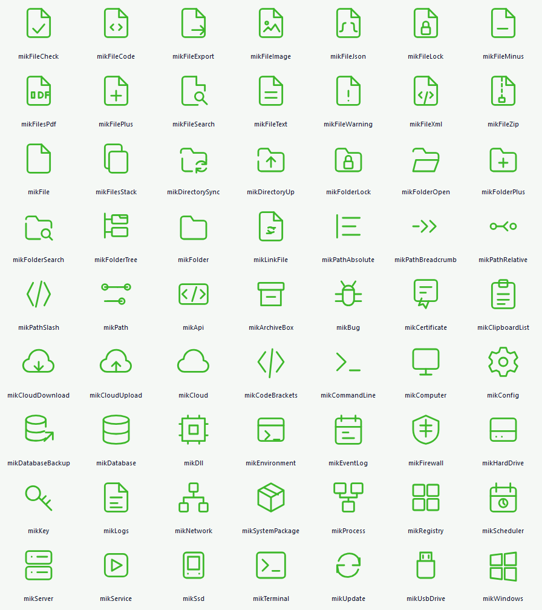

# Catálogo de ícones DAC

O catálogo contém **169 SVGs**, mais `mikNone`. A ampliação de 21/10/2026 inclui **63 ícones** e mantém os 106 originais com os mesmos nomes, valores ordinais, arquivos e geometrias.

| Categoria | Novos ícones |
|---|---:|
| `files` | 16 |
| `folders-paths` | 14 |
| `system` | 33 |

## Configuração

Os ícones ficam na enumeração `TDACIconKind`, disponível no Object Inspector e por código. Use `IconKind` em `TDACButton`, `TDACBadge`, `TDACSummaryCard` e nas ações de coluna de `TDACDBGrid`; em `TDACButtonEdit`, use `ButtonIconKind`.

```pascal
Botao.ShowIcon := True;
Botao.IconKind := mikFolderOpen;
Botao.IconSize := 20;

Card.IconKind := mikDatabase;
Badge.IconKind := mikFileCheck;
CampoArquivo.ButtonIconKind := mikFileJson;
AcaoDaColuna.IconKind := mikFileSearch;
```

O painter compartilhado continua aplicando cor, opacidade e cache. `mikFileCheck` acompanha a semântica de confirmação; `mikFileWarning`, a de alerta. Controles que fornecem uma cor explícita ao painter mantêm essa escolha. Os novos SVGs estão embutidos na unit IconAssets: não é necessário distribuir a pasta assets com a aplicação.

Para evitar colisões, o novo PDF da categoria `files` usa **`mikFilesPdf`** e o pacote de sistema usa **`mikSystemPackage`**. `mikFilePdf` continua sendo o ícone de `report-viewer`; `mikPackage` continua na categoria `data`. As constantes de caminho também foram adicionadas, com prefixos `DAC_ICON_FILES_`, `DAC_ICON_FOLDERS_PATHS_` e `DAC_ICON_SYSTEM_`.

No demo, a seção Botões → Ícones inclui Arquivo JSON, Pasta aberta e Banco de dados. Os demais valores podem ser selecionados nas mesmas propriedades. Depois de recompilar/recarregar os pacotes usados pela IDE, o Object Inspector enumera os novos nomes; nesta entrega os pacotes foram recompilados, sem instalar ou recarregar pacotes na IDE aberta.

## Catálogo ampliado



| IconKind | Nome | Arquivo mestre |
|---|---|---|
| `mikFileCheck` | Arquivo validado | `assets/svg/files/file-check.svg` |
| `mikFileCode` | Arquivo código | `assets/svg/files/file-code.svg` |
| `mikFileExport` | Exportar arquivo | `assets/svg/files/file-export.svg` |
| `mikFileImage` | Arquivo imagem | `assets/svg/files/file-image.svg` |
| `mikFileJson` | Arquivo JSON | `assets/svg/files/file-json.svg` |
| `mikFileLock` | Arquivo protegido | `assets/svg/files/file-lock.svg` |
| `mikFileMinus` | Remover arquivo | `assets/svg/files/file-minus.svg` |
| `mikFilesPdf` | Documento PDF | `assets/svg/files/file-pdf.svg` |
| `mikFilePlus` | Novo arquivo | `assets/svg/files/file-plus.svg` |
| `mikFileSearch` | Buscar arquivo | `assets/svg/files/file-search.svg` |
| `mikFileText` | Arquivo texto | `assets/svg/files/file-text.svg` |
| `mikFileWarning` | Arquivo com alerta | `assets/svg/files/file-warning.svg` |
| `mikFileXml` | Arquivo XML | `assets/svg/files/file-xml.svg` |
| `mikFileZip` | Arquivo ZIP | `assets/svg/files/file-zip.svg` |
| `mikFile` | Arquivo | `assets/svg/files/file.svg` |
| `mikFilesStack` | Arquivos | `assets/svg/files/files-stack.svg` |
| `mikDirectorySync` | Sincronizar diretório | `assets/svg/folders-paths/directory-sync.svg` |
| `mikDirectoryUp` | Diretório superior | `assets/svg/folders-paths/directory-up.svg` |
| `mikFolderLock` | Pasta protegida | `assets/svg/folders-paths/folder-lock.svg` |
| `mikFolderOpen` | Abrir pasta | `assets/svg/folders-paths/folder-open.svg` |
| `mikFolderPlus` | Nova pasta | `assets/svg/folders-paths/folder-plus.svg` |
| `mikFolderSearch` | Localizar pasta | `assets/svg/folders-paths/folder-search.svg` |
| `mikFolderTree` | Árvore de pastas | `assets/svg/folders-paths/folder-tree.svg` |
| `mikFolder` | Pasta | `assets/svg/folders-paths/folder.svg` |
| `mikLinkFile` | Vínculo de arquivo | `assets/svg/folders-paths/link-file.svg` |
| `mikPathAbsolute` | Caminho absoluto | `assets/svg/folders-paths/path-absolute.svg` |
| `mikPathBreadcrumb` | Caminho hierárquico | `assets/svg/folders-paths/path-breadcrumb.svg` |
| `mikPathRelative` | Caminho relativo | `assets/svg/folders-paths/path-relative.svg` |
| `mikPathSlash` | Separador de caminho | `assets/svg/folders-paths/path-slash.svg` |
| `mikPath` | Caminho | `assets/svg/folders-paths/path.svg` |
| `mikApi` | API | `assets/svg/system/api.svg` |
| `mikArchiveBox` | Arquivo morto | `assets/svg/system/archive-box.svg` |
| `mikBug` | Depuração | `assets/svg/system/bug.svg` |
| `mikCertificate` | Certificado | `assets/svg/system/certificate.svg` |
| `mikClipboardList` | Lista de tarefas | `assets/svg/system/clipboard-list.svg` |
| `mikCloudDownload` | Baixar nuvem | `assets/svg/system/cloud-download.svg` |
| `mikCloudUpload` | Enviar nuvem | `assets/svg/system/cloud-upload.svg` |
| `mikCloud` | Nuvem | `assets/svg/system/cloud.svg` |
| `mikCodeBrackets` | Código-fonte | `assets/svg/system/code-brackets.svg` |
| `mikCommandLine` | Linha de comando | `assets/svg/system/command-line.svg` |
| `mikComputer` | Computador | `assets/svg/system/computer.svg` |
| `mikConfig` | Configuração | `assets/svg/system/config.svg` |
| `mikDatabaseBackup` | Backup de banco | `assets/svg/system/database-backup.svg` |
| `mikDatabase` | Banco de dados | `assets/svg/system/database.svg` |
| `mikDll` | Biblioteca DLL | `assets/svg/system/dll.svg` |
| `mikEnvironment` | Ambiente | `assets/svg/system/environment.svg` |
| `mikEventLog` | Log de eventos | `assets/svg/system/event-log.svg` |
| `mikFirewall` | Firewall | `assets/svg/system/firewall.svg` |
| `mikHardDrive` | Disco rígido | `assets/svg/system/hard-drive.svg` |
| `mikKey` | Chave de acesso | `assets/svg/system/key.svg` |
| `mikLogs` | Logs | `assets/svg/system/logs.svg` |
| `mikNetwork` | Rede | `assets/svg/system/network.svg` |
| `mikSystemPackage` | Pacote | `assets/svg/system/package.svg` |
| `mikProcess` | Processo | `assets/svg/system/process.svg` |
| `mikRegistry` | Registro do sistema | `assets/svg/system/registry.svg` |
| `mikScheduler` | Agendador | `assets/svg/system/scheduler.svg` |
| `mikServer` | Servidor | `assets/svg/system/server.svg` |
| `mikService` | Serviço | `assets/svg/system/service.svg` |
| `mikSsd` | Unidade SSD | `assets/svg/system/ssd.svg` |
| `mikTerminal` | Terminal | `assets/svg/system/terminal.svg` |
| `mikUpdate` | Atualização | `assets/svg/system/update.svg` |
| `mikUsbDrive` | Pendrive | `assets/svg/system/usb-drive.svg` |
| `mikWindows` | Windows | `assets/svg/system/windows.svg` |

## Sincronizar novos arquivos

Execute `python tools/sync_icon_assets.py`. O script lê os mestres `assets/svg/<categoria>/*.svg`, acrescenta somente os arquivos ainda não registrados e preserva os ordinais existentes. Usa o manifesto do pacote expandido para os rótulos. As cópias `svg-green` são variantes de cor; não representam outros itens do catálogo. A segunda execução sem novos arquivos não altera o catálogo.

Ao ampliar novamente, revise o inventário/documentação e as expectativas de contagem dos testes. Não reordene a enumeração: suas posições também são usadas em dados serializados e no código de aplicações consumidoras. Casos de nomes repetidos entre categorias devem manter o ícone anterior e receber identificador distinto.

## Validação executada em 21/10/2026

- Projeto existente DACComponentsInteraction: **PASS**. Nova unit DACComponentsIcons.Tests renderiza os 169 ícones pelo painter real em três estilos (verde e branco opacos, vermelho com alpha 128), confirma pixels não vazios e limite de opacidade, metadados e caminhos únicos, RTTI e as propriedades publicadas dos componentes consumidores. Trabalha a partir de uma pasta temporária, sem depender de assets em runtime.
- **169 roundtrips DFM binários** de TDACButton com os valores de IconKind. Os testes usam o registro normal das classes da suíte e registram temporariamente TSkPaintBox para serializar o filho interno, restaurando esse registro depois. Os ordinais anteriores e as duas colisões de nomes são verificados explicitamente.
- Projeto existente DACDemoStartup: **PASS**. Carrega o DFM real do demo, confere os três novos ícones, ativa a página Botões e verifica parent e largura mínima do exemplo.
- **Rebuild Debug/Win32** de runtime, design-time, pacote de compatibilidade, demo e dos dois projetos de teste aprovado no Delphi 10.2. Sem alterar dproj, configurações da IDE ou arquivos da aplicação MaxxRural. Warnings/hints existentes de charts permanecem, sem erros finais.
- Os 63 SVGs embutidos foram comparados exatamente com os mestres locais; enumeração anterior preservada e codificação CP1252/CRLF conferida nos arquivos Delphi alterados. O gerador foi executado novamente e informou catálogo atualizado, sem mutação.
- Inspeção visual do PNG produzido pelo painter: todos os 63 desenhos e seus identificadores estão presentes e legíveis. Não foi feita inspeção manual do Object Inspector/recarga do pacote, nem homologação interativa de todos os ícones em cada tema e DPI.

Logs, scripts de build, PNG, hashes, verificações de formato e diff apenas desta entrega em [evidence/20261021](evidence/20261021/). Os builds foram feitos com saídas isoladas em tmp. A auditoria estática mantém 32 pares de hooks e as 15 famílias, com os oito avisos TODO anteriores; ela não substitui os testes de renderização.
